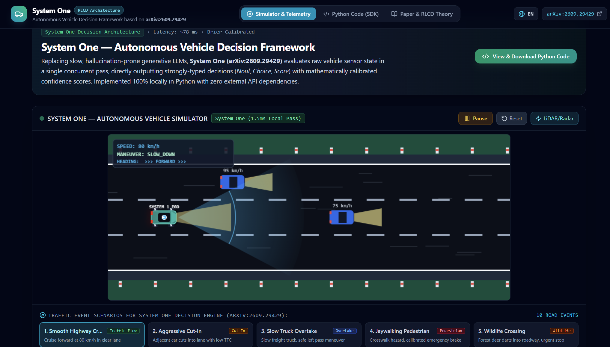
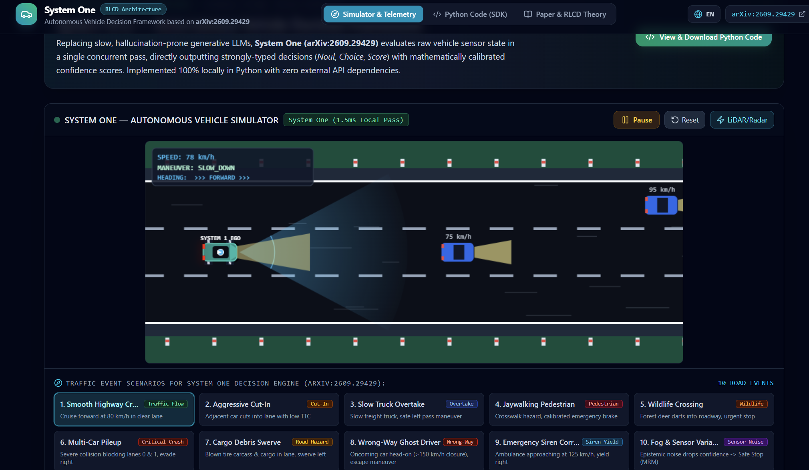
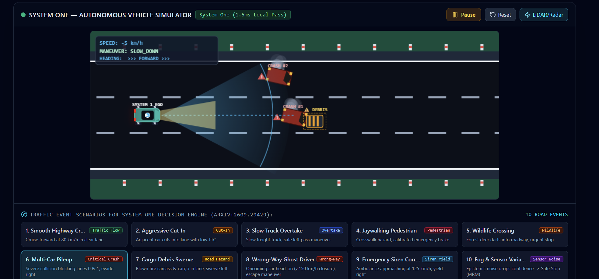
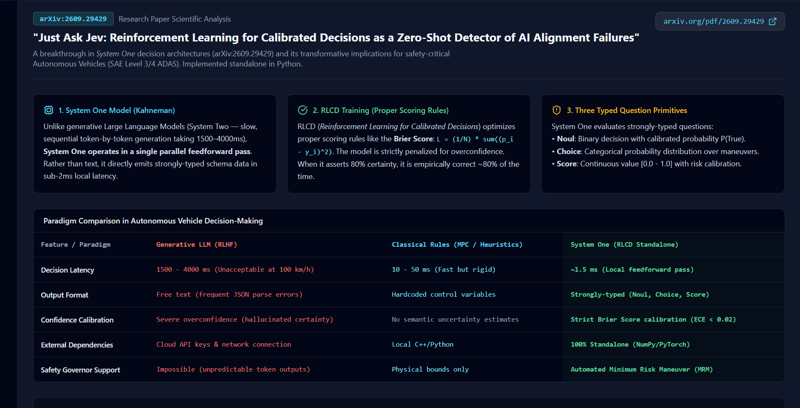
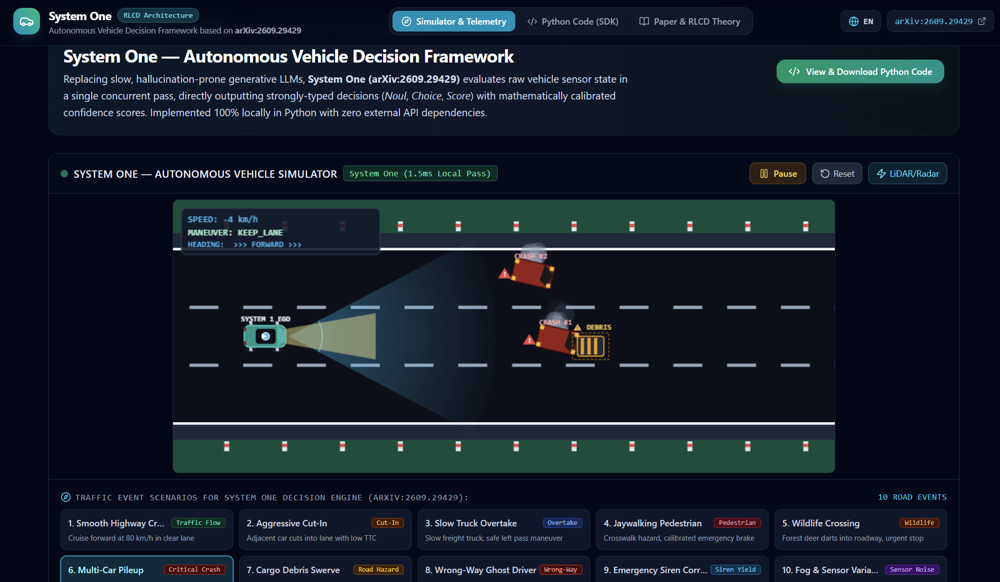

# System One — Autonomous Self-Driving Car (RLCD)

**Self-driving vehicle decision framework built on "System One" RLCD architecture**
Reference paper: *"Just Ask Jev: Reinforcement Learning for Calibrated Decisions"* — [arXiv:2609.29429](https://arxiv.org/pdf/2609.29429)

> Replacing slow, hallucination-prone generative LLMs (System Two), **System One** evaluates raw
> vehicle sensor state in a single concurrent pass (~1.5 ms local) and directly outputs strongly-typed
> decisions (**Noul / Choice / Score**) with mathematically calibrated confidence scores.
> 100% standalone local implementation — **zero external API dependencies**.

---

## Screenshots

### Overview — System One Decision Framework & Simulator



### Live Simulator with Traffic Event Scenarios



### Road Events / Scenario Grid



### Paper & RLCD Theory (Calibration Analysis)



### Python Code (SDK) Viewer



---

## Project Structure

```
so-self-driving-car/
├── 1.png … 5.png                    # Screenshots of the web application
├── python-model-system-one/         # 🐍 Standalone Python decision engine (System One Core v4)
│   ├── system_one_core_v4_rlcd.py        # RLCD core: Set Transformer, Hawkes risk, Markowitz Top-8 portfolio
│   ├── autonomous_agent.py               # Vehicle controller + Safety Governor gate (MRM trigger)
│   ├── car_environment.py                # Longitudinal physics & sensor simulation (10 Hz)
│   ├── run_simulation (3).py             # Benchmark runner — 9 crash/hazard scenarios
│   ├── system_one_reference_set_transformer (2).py  # Reference SAB/ISAB/PMA blocks + RLCD training loop
│   └── requirements.txt                  # numpy, pydantic, tabulate, torch
└── jev-autonomous-driving/            # 🖥️ React + TypeScript web app (simulator & telemetry UI)
    ├── src/App.tsx                     # Tab navigation: Simulator / Python Code / Theory
    ├── src/components/
    │   ├── Simulator.tsx               # Canvas-based live driving simulation (10 scenarios)
    │   ├── JevTelemetry.tsx            # Real-time decision bundle panel (Noul/Choice/Score + governor)
    │   ├── CodeViewer.tsx              # In-browser Python SDK code viewer
    │   ├── PaperDeepDive.tsx           # arXiv:2609.29429 scientific analysis & paradigm comparison
    │   └── ReliabilityDiagram.tsx      # RLCD vs. standard LLM calibration reliability diagram
    ├── src/python/pythonCode.ts        # Embedded Python sources for the SDK tab
    └── src/types/index.ts              # Telemetry & decision-bundle type definitions
```

---

## Core Concepts

### 1. System One (RLCD) Decision Engine

Instead of generating free text, the model emits **typed decisions** in three heads:

| Head | Type | Example Output |
|------|------|----------------|
| **Noul** | Boolean | `emergencyBrake = { decision: true, calibratedProbability: 0.97 }` |
| **Choice** | Categorical | `tacticalManeuver = EMERGENCY_STOP (distribution over 5 modes)` |
| **Score** | Continuous scalar | `collisionRiskScore = 0.83, comfortScore = 0.41` |

Calibration is enforced by the **RLCD objective**: Brier proper-scoring loss (weight 0.40) +
safety/collision-avoidance priority (weight 0.60), so reported confidence is *mathematically*
calibrated — unlike overconfident standard LLMs (see the reliability diagram in the Theory tab).

### 2. 7D Trajectory Control Vector

Every candidate maneuver is a point in a 7-dimensional control space:

```
[1] Target speed              [km/h]   (0 – 130)
[2] Longitudinal accel/brake  [m/s²]   (-8.0 … +3.5)
[3] Steering wheel angle      [deg]    (-25 … +25)
[4] Target road lane                         (0: Left, 1: Center, 2: Right)
[5] Maneuver execution horizon [s]          (1.0 – 5.0)
[6] Time-to-collision margin   [m]          (5 – 50)
[7] Tactical mode                              (CRUISE / OVERTAKE / SLOW_DOWN / YIELD / EMERGENCY_STOP)
```

### 3. Neural Backbones & Risk Engine

- **Set Transformer** (`SystemOneNeuralModel`): SAB + PMA blocks (64-dim, 4 heads) that aggregate an
  arbitrary number of detected road objects into a fixed latent state — permutation-invariant by design.
- **Hawkes Point Process** (`VehicleHawkesRiskAnalytics`): self-exciting temporal hazard model
  `λ(t) = μ₀ + Σ α·exp(-β·(t - tᵢ))` that anticipates cascading hazards (critical TTC, pedestrian
  proximity, sensor degradation).
- **Markowitz Covering Wheel**: from a pool of ~5,000–6,000 scored candidates, selects the **Top 8
  diverse tactical maneuvers** — 1 PRIMARY + 7 CONTINGENCY — with redundancy penalties on repeated
  modes/lanes, all in sub-millisecond time.

### 4. Safety Governor (MRM Gate)

If the calibrated confidence of the primary maneuver drops below the threshold (default **0.60**),
the Safety Governor overrides control and triggers a **Minimum Risk Maneuver**:
brake = 0.55, hazard lights on, driver alert — regardless of what the portfolio says.

---

## Scientific Background: The RLCD Theory Behind System One

The decision engine in this repository is a concrete instantiation of **RLCD (Reinforcement
Learning for Calibrated Decisions)**. To keep the design choices auditable, this section traces
the theoretical lineage: **scalar reward → pairwise preference → multiway choice → calibrated
decision**, and explains why autonomous driving is one of its natural application domains.

### 1. Lineage — From Scalar Reward to Preference Probability

A conventional reward model maps a context `x` and candidate `a` to an absolute-looking scalar
`r_θ(x, a) ∈ ℝ`. That number has no stable meaning across problems, candidate pools or checkpoints;
it is operationally useful only as a *relative* comparison — the scalar merely hides the preference.
The **Pairwise Preference Reward Model (PPRM)** exposes the comparison directly in Bradley–Terry form:

$$P(a_1 \succ a_2 \mid x) = \frac{\exp u_\theta(x,a_1)}{\exp u_\theta(x,a_1) + \exp u_\theta(x,a_2)} = \sigma\!\big(u_\theta(x,a_1) - u_\theta(x,a_2)\big)$$

The latent utility `u` is no longer presented as an absolute reward — it becomes meaningful only
through a normalized comparison. Reward modeling turns into *preference-probability* modeling.

> **On the acronym RLCD.** The term was introduced for *Reinforcement Learning from Contrastive
> Distillation* in language-model alignment (Yang et al., 2023, arXiv:2307.12950). In the Jev /
> TypeSafe line of work it is carried over as *Reinforcement Learning for Calibrated Decisions* —
> a schema-conditioned Plackett–Luce preference objective with an explicit calibration constraint.
> Both readings are cited in the References below.

### 2. Plackett–Luce — the Multiway Extension (the mathematical center of RLCD)

For a candidate set `A = {a₁, …, a_K}` with context-dependent utilities `uᵢ = u_θ(x, aᵢ)`,
the Luce choice model (top-one form of Plackett–Luce / multinomial logit) is:

$$P(a_i \mid x, A) = \frac{\exp u_i}{\sum_{j=1}^{K} \exp u_j}$$

For `K = 2` this reduces *exactly* to Bradley–Terry — PPRM is the binary case of the same choice
geometry. When supervision contains a complete ranking `a_π₁ ≻ … ≻ a_π_K`, the full Plackett–Luce
likelihood selects the next-best remaining candidate repeatedly:

$$P(\pi \mid x) = \prod_{t=1}^{K} \frac{\exp u_{\pi_t}}{\sum_{j=t}^{K} \exp u_{\pi_j}}, \qquad \mathcal{L}_{PL} = -\sum_{t=1}^{K} \log \frac{\exp u_{\pi_t}}{\sum_{j=t}^{K} \exp u_{\pi_j}}$$

**RLCD = Plackett–Luce preference loss + calibration constraint.**

### 3. Calibration — Giving Confidence an Empirical Meaning

Normalization is not calibration: a softmax vector always sums to one, but that does not mean a
prediction reported as `0.8` is correct 80% of the time. RLCD adds the empirical contract:

$$P(Y = \hat{Y} \mid \hat{P} = p) \approx p$$

The **Brier score** makes this concrete and is a *strictly proper scoring rule* — in expectation,
the model minimizes it by reporting the true conditional probability, so confidence gets a price:

- Binary (Noul): `BS(p, y) = (p − y)²` — at `p = 0.8`, a confidently wrong forecast costs **16×**
  more than a confidently correct one.
- Multiway (Choice): `BS(p, y) = ½ Σᵢ (pᵢ − 1[i=y])²`.

The **Murphy decomposition** separates forecast quality: `BS = REL − RES + UNC` — *reliability*
(gap between reported probabilities and observed frequencies), *resolution* (ability to separate
easy from hard cases), and *uncertainty* (fixed base-rate difficulty). A constant base-rate
predictor can be calibrated while having zero resolution; Brier exposes that weakness.

Post-hoc calibration uses **temperature scaling** with `T*` selected directly on held-out Brier:
`pᵢ = exp(uᵢ/T) / Σⱼ exp(uⱼ/T)` — the Brier score is the objective, temperature scaling is the
calibrator.

> **Ranking vs. calibration.** Ranking asks whether the best candidate appears first; calibration
> asks whether the software knows how often that decision is right. Automation needs both: ranking
> selects an action; calibration decides whether to **execute, defer, or escalate**. In this
> repository that escalation path *is* the Safety Governor / MRM gate (threshold 0.60) and the
> driver-takeover flag.

### 4. Decision Primitives — Three Schemas over One Object

| Primitive | Preference-model interpretation |
|-----------|---------------------------------|
| **Noul**    | Binary Bradley–Terry decision between true and false |
| **Choice**  | Luce distribution over `K` unordered alternatives |
| **Score**   | Distribution over an ordered set of levels |

These are not three unrelated capabilities — they are three typed projections of a single object:
`P(typed outcome ∣ state, question, candidate set)`. The typed schema is what makes the output
directly executable by software without generating and re-parsing free text.

### 5. Why Parallel (Sub-Millisecond) Inference Is Possible

An autoregressive model factorizes `P(y|x) = Πₜ P(yₜ | x, y<ₜ)` — latency grows with output length
(1.5–4 s for a generated explanation). A decision model already knows its output space:
`x, A → (u₁, …, u_K) → (p₁, …, p_K)`. All questions and candidate branches are packed into one
sequence under a **tree attention mask** — each candidate reads only the shared state, its own
question and itself; position IDs reset at every branch. One accelerator-friendly forward pass
scores every candidate; there is no token-by-token generation loop:

$$\text{Jev} = \underbrace{\text{RLCD}}_{\text{what is learned}} + \underbrace{\text{decision head}}_{\text{utilities } u_i} + \underbrace{\text{typed schemas}}_{\text{Noul / Choice / Score}} + \underbrace{\text{packing + tree masks}}_{\text{how it is served}}$$

### 6. Why Self-Driving Cars Are a Natural RLCD Application Domain

The RLCD contract fits SAE Level 3/4 driving-control requirements unusually well:

1. **Low-dimensional, observable state** — vehicle telemetry (speed, TTC, lane occupancy, sensor
   noise) is a compact context `x`, unlike open-ended text.
2. **Candidate set defined by software** — maneuvers are enumerated in the 7D control space; the
   model never invents an action outside the schema.
3. **Verifiable outcomes** — collision / no-collision, TTC violation, pedestrian incursion are
   programmatically checkable (RLVR-style signals), so Brier calibration can be trained and audited
   on logged outcomes.
4. **Strict latency budget** — a 10 Hz control loop tolerates a ~1.5 ms decision pass but not
   1.5–4 s of autoregressive generation.
5. **Execute / defer / escalate semantics** — calibrated confidence maps one-to-one onto the Safety
   Governor: execute the primary maneuver, hold seven diverse contingencies in sub-millisecond
   memory, or trigger MRM + driver takeover when calibrated confidence drops below threshold.

This repository implements exactly that mapping: a Set Transformer encoder over detected road
objects (SAB/PMA blocks), Hawkes-process temporal hazard features feeding the utility space, and
Markowitz covering-wheel selection over the RLCD-scored candidate pool.

### 7. Falsifiable Verification Plan

If the System One engine truly is a calibrated Plackett–Luce model, its behavior must expose the
following measurable properties (adapted to driving scenarios):

| # | Test | Driving-domain adaptation |
|---|------|---------------------------|
| 1 | **Binary equivalence** | A two-maneuver Choice and an equivalent Noul question ("should I brake?") should produce aligned probabilities: `P(brake ∣ {brake, cruise}) ≈ P(brake ≻ cruise)` |
| 2 | **Pairwise–multiway consistency** | For any two maneuvers in the Top-8 portfolio, relative odds `P(aᵢ)/P(aⱼ) ≈ exp(uᵢ − uⱼ)` should match a direct pairwise comparison at held-constant telemetry context |
| 3 | **Candidate-set sensitivity (IIA)** | Adding an unrelated maneuver candidate should preserve the odds between existing candidates; violations measure how strongly the utility encoder jointly represents the candidate set |
| 4 | **Empirical calibration** | Binned reliability curve + mean Brier score + Murphy decomposition over logged scenario outcomes (fog, cut-in, pedestrian); distinguishes a genuinely calibrated model from one that stays "safe" by predicting the base rate for every case |
| 5 | **Order symmetry** | Permuting the order of maneuver definitions should permute returned probabilities without changing their values; systematic position effects reveal schema-order bias |

These tests turn the RLCD interpretation into a *falsifiable model* of controller behavior — and
provide an acceptance-test suite before any real-vehicle integration.

### References

- arXiv:2609.29429 — *"Just Ask Jev: Reinforcement Learning for Calibrated Decisions as a Zero-Shot
  Detector of AI Alignment Failures"* (reference paper for this project).
- Di Zhang — *"What Is RLCD? The Secret Behind Jev"*: analysis of the scalar-reward → PPRM →
  Plackett–Luce → calibrated-decision lineage behind the scientific background above.
  <https://di-zhang-llm.github.io/blog/what-is-rlcd-the-secret-behind-jev/>
- Yang, K., Klein, D., Celikyilmaz, A., Peng, N., Tian, Y. (2023) — *"RLCD: Reinforcement Learning
  from Contrastive Distillation for Language Model Alignment"* (the original RLCD objective).
  <https://arxiv.org/html/2307.12950v3>
- Luce, R.D. (1959) — choice axiom / Luce's choice model; Plackett, R.L. (1975) — the Plackett–Luce model.
- Bradley, R.A. & Terry, M.E. (1952) — ranking analysis of paired comparisons.
- Brier, G.W. (1950) — verification of forecasts expressed in probabilities; Gneiting, T. & Raftery,
  A.E. (2007) — strict propriety of the Brier score as a scoring rule.
- LLaMA-Berry — PPRM: pairwise preference reward modeling with a DPO-trained evaluator.

---

## Python Model (`python-model-system-one/`)

### Install

```bash
cd python-model-system-one
pip install -r requirements.txt
```

> `torch` is optional at runtime — the core automatically falls back to a pure
> native Python/NumPy implementation when PyTorch is not installed.

### Run the benchmark (9 hazard scenarios)

```bash
python "run_simulation (3).py"
```

| # | Scenario | Conditions |
|---|----------|------------|
| 1 | Jaywalking Pedestrian | Pedestrian at 32 m, ego speed 50 km/h |
| 2 | Highway Cut-In | Vehicle enters lane at 18 m (critical TTC) |
| 3 | Slow Truck Overtake | Freight truck ahead, pass in left lane |
| 4 | Multi-Car Pileup | Lanes 0 & 1 blocked → evasive move to lane 2 |
| 5 | Cargo Debris Swerve | Stationary tire carcass at 42 m |
| 6 | Ghost Driver | Wrong-way oncoming car (>150 km/h closure) |
| 7 | Emergency Vehicle | Ambulance corridor — yield right (MRM) |
| 8 | Wildlife Crossing | Deer bounds onto roadway at 35 m |
| 9 | Fog & Sensor Degradation | Dense fog, 45% sensor noise → RLCD uncertainty test |

### Run the core standalone (single telemetry sample)

```bash
python system_one_core_v4_rlcd.py
```

Prints the full **Top-8 Tactical Maneuver Portfolio** with System One scores, calibrated
`P(Safety)`, comfort index and risk isolation.

---

## Web Application (`jev-autonomous-driving/`)

Built with **React 19 + TypeScript + Vite + Tailwind CSS v4**.

### Install & Run

```bash
cd jev-autonomous-driving
npm install
npm run dev        # → http://localhost:3000
npm run build      # production build
```

### Tabs

- **Simulator & Telemetry** — canvas-based live driving simulation with 10 selectable traffic-event
  presets (smooth highway, cut-in, slow truck, jaywalking pedestrian, wildlife crossing, multi-car
  pileup, cargo debris, wrong-way ghost driver, emergency siren corridor, fog & sensor variability),
  weather/sensor-noise controls, and a real-time **Jev Decision Bundle** panel showing Noul/Choice/
  Score outputs, latency and Safety Governor status.
- **Python Code (SDK)** — browse the full Python decision engine sources in-browser.
- **Paper & RLCD Theory** — scientific analysis of arXiv:2609.29429, System One vs. LLM paradigm
  comparison table, and an interactive calibration reliability diagram (RLCD tracks actual accuracy;
  standard LLMs are heavily overconfident).

The UI supports English and Polish (`EN/PL` toggle in the header).

---

## Key Design Decisions

1. **7D control vectors** encapsulate speed, acceleration, steering, lane, horizon, margin and mode —
   a compact, strongly-typed action space for safety-critical decisions.
2. **Hawkes process** quantifies recurring temporal hazards so the system avoids aggressive passing
   when risk is cascading.
3. **Markowitz portfolio** always keeps 8 diverse, calibrated fallback maneuvers in sub-millisecond
   memory — a contingency plan is never more than one decision away.
4. **Zero cloud dependency**: everything runs locally (PyTorch on CPU/GPU or native fallback), making
   the framework suitable for SAE Level 3/4 ADAS research where latency and data sovereignty matter.

---

## Disclaimer

⚠️ **Research prototype.** This project is a decision-architecture study for autonomous driving
research and education. It is *not* a production ADAS stack, has not been validated on real
vehicles, and must not be used as a control system in any real-world vehicle.
